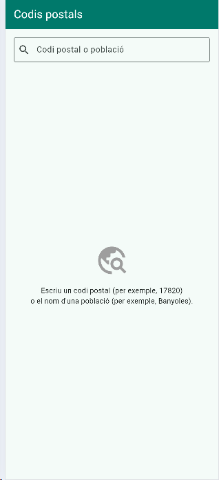
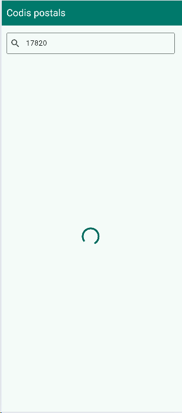
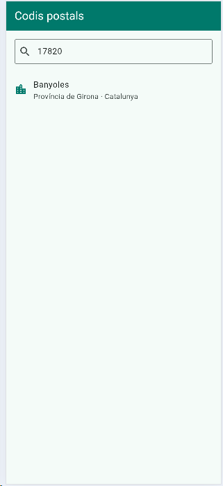
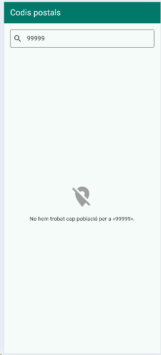
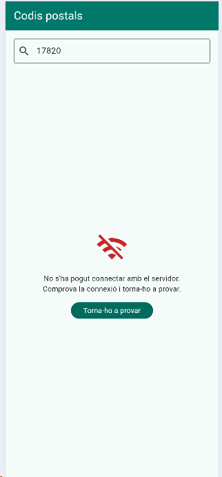
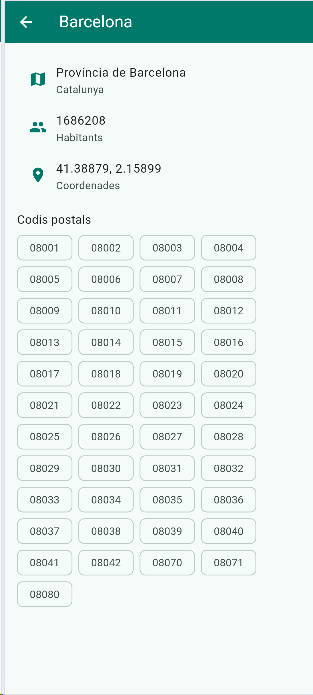
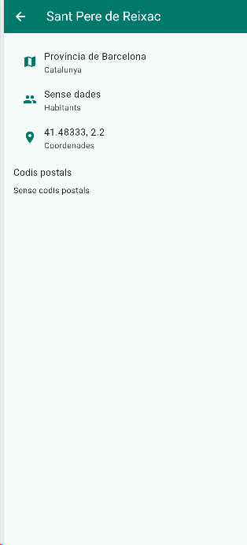

# Codis postals · Actividad de evaluación 1.4 – Una app con API

App que busca poblaciones de España por código postal o por nombre con la API de geocodificación de Open-Meteo.

**Alumna:** María Carolina Kaechele Smoly
**Nivel:** Ampliación (Base + Ampliación)

## Capturas

| Inicio | Cargando | Resultados | No encontrado | Error |
|---|---|---|---|---|
|  |  |  |  |  |

| Detalle (Barcelona) | Detalle sin datos (Sant Pere de Reixac) |
|---|---|
|  |  |

## Estructura del código

```
lib/
├── main.dart
├── models/
│   ├── search_response.dart   Respuesta de la API (lista results)
│   ├── place.dart             Cada población
│   └── search_status.dart     Los 5 estados de la pantalla
├── screens/
│   ├── search_screen.dart     Pantalla de búsqueda
│   └── place_detail_screen.dart  Detalle de una población
├── styles/
│   └── app_styles.dart        Colores y espacios
└── widgets/
    ├── message_view.dart      Icono + mensaje (+ botón)
    └── place_tile.dart        Una fila de la lista
```

## Qué he hecho

| Parte | Cómo lo he hecho |
|---|---|
| Modelo | Clases generadas con quicktype a partir de la respuesta de «Sant Pere», donde hay poblaciones sin `population` ni `postcodes`; así quicktype los marca como opcionales (`int?`, `List<String>?`). |
| Respuesta sin resultados | Con el 99999 la API no envía la clave `results`. He cambiado `SearchResponse.fromJson` para que, si es `null`, use una lista vacía. |
| `elevation` | quicktype lo había deducido como `int` porque los valores parecían enteros (`168.0`). Lo he cambiado a `double?` con `toDouble()`. |
| Búsqueda | `TextField` con `TextInputAction.search` y `onSubmitted`. La URL se construye con `Uri.https`, que codifica los espacios («Sant Pere»). |
| Estados | Un `enum SearchStatus` y un `switch` que muestra un widget distinto para cada estado: inicio, cargando, resultados, no encontrado y error. |
| Detalle | `PlaceDetailScreen` recibe la `Place` elegida y muestra nombre (en el `AppBar`), provincia, comunidad, habitantes, coordenadas y todos los códigos postales. Se abre con `Navigator.push`; al volver con la flecha atrás, los resultados siguen ahí porque la pantalla de búsqueda no se destruye. |
| Códigos postales | Un `Wrap` con un `Chip` por código, que salta de línea solo (Barcelona tiene 45). Se ordenan con `sort()` y, si no hay, se muestra «Sense codis postals». |
| Datos que faltan | Si no hay habitantes se muestra «Sense dades» (por ejemplo, Sant Pere de Reixac). |
| No encontrado vs error | Si la respuesta llega bien pero sin poblaciones → no encontrado. Si la llamada falla (sin conexión o `statusCode` distinto de 200) → error, con un botón para volver a intentarlo. |

## Buenas prácticas

- Todos los colores y espacios salen de `AppStyles`.
- Una clase por archivo, separadas en `models`, `screens`, `widgets` y `styles`.
- Nombres del código en inglés; los textos de la pantalla en catalán.
- `MessageView` se reutiliza para tres estados en lugar de repetir código.

## Notas

- Las capturas están hechas con Chrome. El estado de error se ha probado poniendo Chrome en modo *Offline* (F12 → Network), el equivalente al modo avión.

## Reflexión

**Cómo me he puesto:**
Primero abrí la dirección de la API en el navegador con varios casos (17820, 17469, Barcelona, 99999 y Sant Pere) para ver qué llegaba antes de escribir código. Hice una primera versión, pero no la entendía del todo, así que decidí empezar de cero e ir paso a paso: modelos, estilos, widgets y, al final, la pantalla de búsqueda, probando cada parte antes de pasar a la siguiente. He utilizado un asistente de IA como guía para entender el código paso a paso y resolver los problemas que me iban saliendo.

**Qué me ha salido bien:**
Los cinco estados de la pantalla funcionan y cada uno tiene su mensaje. También me ha gustado crear `MessageView` y reutilizarlo para el inicio, el «no encontrado» y el error en lugar de repetir el mismo código tres veces.

**Qué me ha costado:**
Entender el modelo: qué hace `fromJson` y por qué algunos campos llevan `?`. También perdí tiempo con el emulador de Android, que no arrancaba, así que trabajé en Chrome. Y capturar el estado «cargando», que dura tan poco que tuve que añadir un retraso temporal para poder hacer la captura.

**Qué me ha sorprendido:**
Que con el 99999 la API no devuelve una lista vacía, sino que directamente no envía la clave `results`, y eso hacía petar la app. También que quicktype se equivocara con `elevation`: como los valores parecían enteros (`168.0`), lo puso como `int`. quicktype solo sabe lo que le enseñas.

**Qué he aprendido:**
A conectar una app a una API con `http`, a convertir el JSON en clases de Dart y a controlar los estados de una pantalla con un `enum` y un `switch`. Sobre todo, la diferencia entre «no encontrado» (la respuesta llega bien pero vacía) y «error» (la llamada falla).

**Qué cambiaría:**
Me gustaría solucionar el problema del emulador de Android y probar la app en un móvil, porque en Chrome algunas cosas funcionan distinto. También me gustaría mejorar el diseño y hacer el Reto: el tiempo en el detalle y las búsquedas recientes.