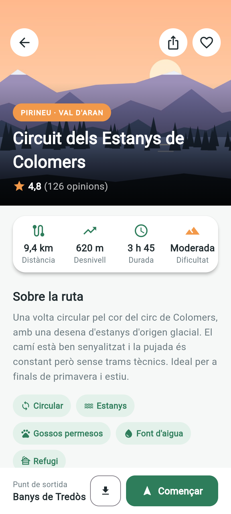
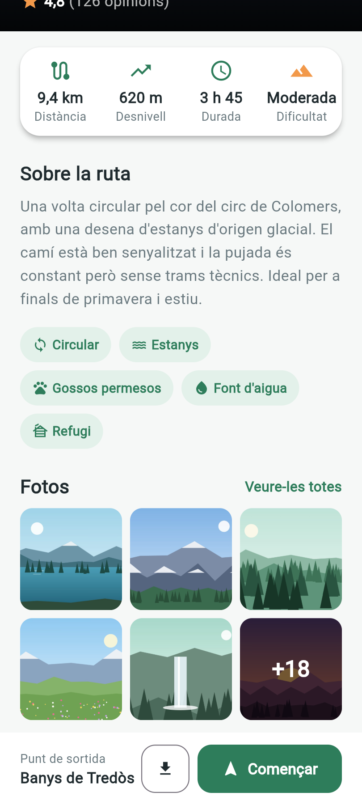
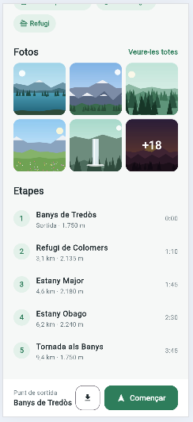

# Camins · Activitat d'avaluació 1.3 – De disseny a pantalla

Fitxa d'una ruta de muntanya feta amb Flutter a partir d'un disseny.

**Nivell:** Ampliació + dos detalls del Repte (botons rodons i «+18» a l'última foto)

## Captures

| Inici                              | Fotos                              | Etapes                               |
| ---------------------------------- | ---------------------------------- | ------------------------------------ |
|  |  |  |

## Estructura del codi

```
lib/
├── main.dart
├── screens/
│   └── trail_detail_screen.dart   Pantalla amb totes les zones
├── styles/
│   └── app_styles.dart            Colors, separadors i estils de text
└── widgets/
    ├── trail_header.dart          Zona 2 · Capçalera
    ├── round_icon_button.dart     Zona 1 · Botó rodó (Repte)
    ├── stat_item.dart             Zona 3 · Una dada de la fitxa
    ├── tag_chip.dart              Zona 4 · Una etiqueta
    └── stage_tile.dart            Zona 6 · Una etapa
```

## Què he fet a cada zona

| Zona               | Nivell    | Com l'he fet                                                                                                                                                  |
| ------------------ | --------- | ------------------------------------------------------------------------------------------------------------------------------------------------------------- |
| 1 · Botons         | Repte     | Tres `RoundIconButton` (un `IconButton` blanc de 44 × 44) col·locats amb `Positioned` sobre la imatge.                                                        |
| 2 · Títol          | Base      | `Stack` amb la imatge (`BoxFit.cover`), un `LinearGradient` de transparent a negre i un `Positioned` amb la regió, el títol i la valoració.                   |
| 3 · Fitxa de dades | Base      | `Card` blanc amb una `Row` de quatre `Expanded`, cadascun amb un `StatItem`. La icona de Dificultat és taronja gràcies a un paràmetre opcional (`iconColor`). |
| 4 · Sobre la ruta  | Base      | Títol, text i un `Wrap` de `TagChip` que salten de línia sols quan no caben.                                                                                  |
| 5 · Fotos          | Ampliació | `GridView.count` de 3 columnes amb `shrinkWrap` i `NeverScrollableScrollPhysics`. Les fotos es generen amb un bucle `for` i s'arrodoneixen amb `ClipRRect`.   |
| 5 · «+18»          | Repte     | L'última foto és un `Stack` amb la imatge, una capa fosca i el text «+18» centrat.                                                                            |
| 6 · Etapes         | Ampliació | Cinc `StageTile` basats en `ListTile`, amb el número dins d'un `CircleAvatar`.                                                                                |
| 7 · Barra inferior | Base      | `bottomNavigationBar` de l'`Scaffold`, sempre visible encara que facis scroll.                                                                                |

## Bones pràctiques

- Tots els colors, espais i estils de text surten d'`AppStyles`.
- Una classe per fitxer, separades a `screens`, `widgets` i `styles`.
- Noms del codi en anglès; els textos de la pantalla en català.
- Widgets propis amb paràmetres reutilitzats en lloc de copiar i enganxar codi.
- Codi formatat amb `dart format` i revisat amb `flutter analyze`.

## Notes

- He fet servir les imatges que es corresponen amb el disseny.
- L'emulador d'Android em donava problemes, així que vaig desenvolupar i fer les captures amb Chrome en mode dispositiu (Pixel 9, 412 × 924).

## Reflexió

**Com m'hi he posat:**
M'he sentit força desafiada. Flutter és una manera nova de programar per a mi: tot són widgets dins d'altres widgets. Vaig anar zona per zona, de dalt a baix, i molts cops línia per línia, provant cada canvi a la pantalla abans de continuar.

**Què m'ha sortit bé:**
En general, la pantalla m'ha sortit bé i s'assembla molt al disseny. Estic contenta d'haver creat widgets propis (`StatItem`, `TagChip`, `StageTile`…) i reutilitzar-los en lloc de copiar el mateix codi diverses vegades.

**Què m'ha costat:**
Al principi em va costar entendre l'estructura i com funcionava: on va cada bloc, què tanca cada parèntesi i com encaixen els widgets els uns dins dels altres. També em va donar feina l'emulador d'Android.

**Què m'ha sorprès:**
La facilitat per crear una sola app per a diferents plataformes: la mateixa pantalla funciona a Android, a la web o a Windows. També em va sorprendre la idea de les capes amb `Stack`, com posar un degradat entre la imatge i el text perquè es llegeixi bé.

**Què he après:**
He après a fer servir Flutter per construir una pantalla a partir d'un disseny. Sobretot, he entès la diferència entre una classe (el motlle, per exemple `StatItem`) i els objectes que en creo (cada `StatItem(...)` amb les seves dades), i quan fer servir `Row`, `Column`, `Stack`, `Expanded` o `Wrap`.

**Què canviaria:**
Reduiria el codi del fitxer principal, `trail_detail_screen.dart`. Encara té blocs llargs, com la fitxa de dades o la barra inferior, que podria treure als seus propis widgets perquè el codi quedés més net, més curt i més fàcil de llegir.
